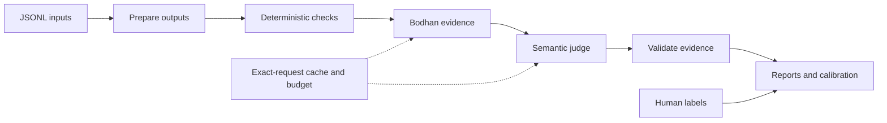
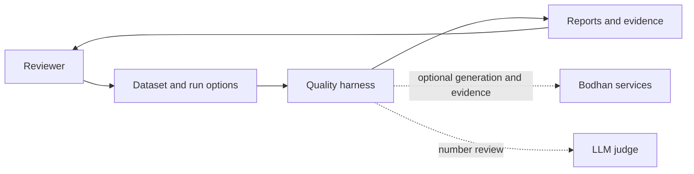
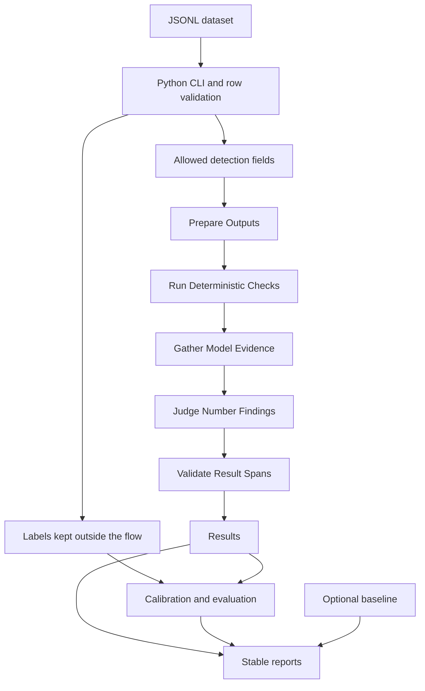
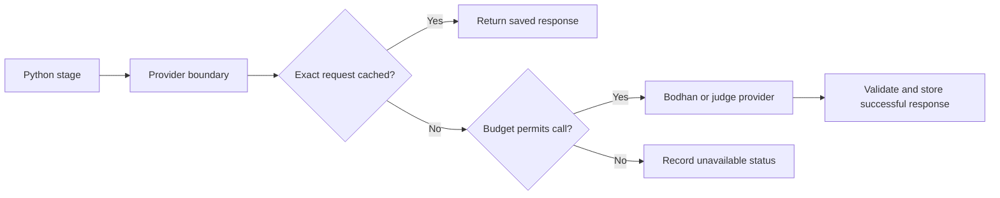

> **Checkpoint status:** The detailed milestone description below is historical and does not reflect all current checks. Use the [README](README.md) and the summary here for current behavior. A full architecture refresh remains pending.
>
> The headless exported Langflow graph delegates to Python modules for preparation, number and formatting checks, Bodhan back-translation and transcription, semantic judgment, speech checks, and original-span validation. Successful model responses are cached and costs are budgeted; annotations are joined only after detection. Human calibration is descriptive and based on 12 previously inspected items. Reference scoring, wrong-language detection, calibrated thresholds, and the compact residual-ID judge remain pending.

---

# Current architecture

This guide describes the current milestone. The [plan](PLAN.md) describes later work. The [README](README.md) gives setup and run commands. The [assignment](<../../../../bodhan/Agentic Engineer Take-Home Translation and Speech Quality Harness.md>) gives the full requirements.

## Problem statement

Bodhan needs a way to find quality errors in Indic translations and generated speech. A model team needs to know what failed, where it failed, and how results change between runs. Many items have no reference translation. The checks must also work on new datasets and languages.

The assignment asks for an unattended harness that reads English source text and evaluates Indic text and audio. It must identify errors such as changed numbers, missing content, broken formatting, speech omissions, and repeated speech. Each finding needs a category, severity, and evidence. Reports must show results by language and error category, cost, and changes from a baseline.

The hard part is to find real errors without treating checker mistakes as product errors. Back-translation, transcription, and the LLM judge can each make mistakes. The harness must also limit cost, retain original text positions, and measure results against labels.

## Solution approach

We are building a Python command-line harness with a Langflow graph. The command reads the dataset and starts the graph through LFX. The graph runs small Python stages in a fixed order. The stages prepare outputs, check numbers, collect model evidence, request a judgment when eligible, and validate evidence spans.

The current milestone establishes this path with a conservative number check. It records uncertain cases and unavailable checks so that the report shows the limits of the result. It keeps labels outside detection and joins them later for evaluation. It also caches successful requests and tracks estimated cost.

The full solution still needs the remaining translation and speech checks, an error injector, and calibrated thresholds. It also needs live provider verification and the required 100-item demo. The [plan](PLAN.md) lists these later stages. The current milestone does not yet meet the full assignment scope.

## Progress checklist

The basic execution path is in place. The full quality harness is still in progress. The remaining detectors and quality measurements are substantial.

### Done

- [x] **Dataset and command-line path.** The harness reads JSONL records and continues after a malformed row. One bad item cannot stop the full run.
- [x] **Langflow pipeline.** Five connected stages coordinate the work. Python modules implement the stages so that their logic can be tested separately.
- [x] **Initial number check.** The check recognizes equivalent Unicode digits. It reports changed values only in limited cases with a supported matching unit. This reduces false alarms.
- [x] **Evidence locations.** Number findings use offsets into the original text. A reviewer can locate the text behind each finding.
- [x] **Provider boundaries.** Adapters handle the three Bodhan operations and the LLM judge. They provide one place to handle requests and failures.
- [x] **Failure and status reporting.** Missing inputs, missing settings, and failed calls can be marked unavailable. Unfinished checks are marked pending. This makes gaps in the evidence visible.
- [x] **Cache and cost controls.** The harness caches successful responses by request. A cost cap can block calls. These controls reduce repeat costs and make spending visible.
- [x] **Reports and baseline comparison.** The harness writes the required report files and can compare findings with an earlier run. An unavailable check does not resolve an earlier finding.
- [x] **Label isolation.** The harness joins labels after detection. This lets it evaluate findings without giving the detector the answers.
- [x] **Offline verification.** A 10-row fixture and tests exercise the CLI, graph, number check, provider boundaries, and cached replay. The editor renders all five connected stages.

### Still to do

- [ ] **Verify real provider calls.** API keys are needed to test actual translation, speech generation, transcription, and judge responses. Offline responses test the code path. They do not establish live model behavior.
- [ ] **Complete translation checks.** Add checks for omissions, additions, mistranslations, terms and entities, formatting, and wrong language or script. These cover errors outside the number check.
- [ ] **Complete speech checks.** Compare speech transcripts with expected text. Check for omissions, repetition, silence, clipping, and other audio problems. These checks are needed to evaluate speech quality.
- [ ] **Handle noisy checkers.** Back-translation and transcription can introduce errors. Tests and decision rules must distinguish checker errors from errors in the original output.
- [ ] **Complete judge design and calibration.** Write the full rubric, measure consistency, and tune thresholds from suitable human labels. This shows how much confidence to place in judge decisions.
- [ ] **Build the error injector and demo dataset.** Include at least 100 items across Hindi, Tamil, and Bengali. Add injected errors and a labelled subset. These give the harness known cases to find or miss.
- [ ] **Measure quality.** Measure recall, false alarms on clean items, span overlap, and category accuracy by language and error type. These results show how well the harness detects errors.
- [ ] **Complete operational hardening.** Add retries with backoff, concurrency limits, and broader audio handling. Run the required runtime benchmark. These support larger runs and provider failures.
- [ ] **Finish submission materials.** Prepare a sample report, a short demo video, and final validation. The user will open the PR and send the email.

The small live-provider smoke test needs API keys. The remaining detectors and clean controls can also be developed and tested offline.

## Product view

The harness helps a reviewer find possible errors in translated numbers. It accepts an English source and an Indic translation. It can also accept audio and a reference. The report shows findings, evidence, and checks that could not run.

The current number check has a narrow scope. The full translation and speech quality checks are pending. The current output does not measure overall model quality. Live provider responses have not yet been verified.

The harness uses supplied outputs when they exist. The `--generate` option fills missing outputs. This makes it possible to review existing work and generated work through the same path.

The number check compares Unicode decimal values. For example, `२५` and `25` have the same value. A changed value is a finding only when both texts have one number with the same supported explicit unit. Other uncertain cases are inconclusive. This rule reduces false alarms when the harness cannot establish a reliable match.

## Execution path

The CLI reads each row independently. A bad row does not stop valid rows. The CLI resolves relative audio paths from the dataset directory. It passes allowed fields to the exported graph through LFX 1.13.2. The CLI then joins labels and writes reports.

The saved Langflow graph has five connected nodes. Each custom component passes its input to a Python stage. The graph shows the order of work. Conditional provider calls are currently inside Python stages. The graph has no visible conditional branch yet.

| Stage | Current work | Reason |
| --- | --- | --- |
| Prepare Outputs | Keep supplied text and audio. Generate missing outputs when requested. | A reviewer can use existing outputs. |
| Run Deterministic Checks | Compare decimal numbers. Mark other checks as pending. | The first check has a clear, testable scope. |
| Gather Model Evidence | Request back-translation and transcription when inputs are available. | These outputs provide evidence for later checks. |
| Judge Number Findings | Request a judgment when a number finding is eligible. | The judgment gives separate evidence for review. |
| Validate Result Spans | Check that finding spans match the original text. | A reviewer can locate the evidence. |

The deterministic candidate supplies the number finding. The judge verdict is recorded separately. Missing settings, failed calls, and missing inputs get explicit statuses. A pending or unavailable check cannot prove that an item is clean.

## Evidence and labels

The number check keeps the original text. It compares decimal values and records offsets into named original fields. The offsets are Unicode code-point positions. The start is included and the end is excluded. Thus, `text[start:end]` gives the evidence text.

Labels and injection metadata stay outside detection inputs and prompts. This separation prevents annotations from changing the findings. After the graph runs, the report code joins labels by item and language. An empty label list marks an annotated clean item. An absent label list marks an unlabelled item. Current calibration gives descriptive number counts when suitable labels exist. Threshold tuning and judge calibration are pending.

## Providers, cache, and cost

Indic-Translate supplies translation and back-translation. Indic-Speak supplies speech. Indic-Transcribe supplies transcription. The LLM judges evidence. It does not generate or correct Indic text.

The cache key includes the provider, operation, model, settings, and relevant request content. Audio requests use the audio bytes. Secrets are excluded. A cache hit avoids a provider call. `--cache-only` prevents provider dispatch. Failed calls can be attempted in a later run.

The cost cap applies before uncached calls. When a cap is set, an unpriced judge call is unavailable. Requests run serially in this milestone. The stable reports retain the original estimated cost. The separate runtime file records calls, cache hits, latency, and incremental cost. A complete replay can therefore retain the same report bytes and record zero new provider calls.

## Reports and current limits

`summary.md` gives the main results. `summary.json` gives machine-readable counts. `items.jsonl` gives item statuses, findings, and evidence. `calibration.json` gives label-based counts or an unavailable status. `diff.md` is added when a baseline is supplied. An unavailable current check does not resolve an earlier finding.

The current check does not establish correspondence for every numeric format. Dates, ranges, grouped numbers, fractions, and several other formats are inconclusive. Spelled-out numbers and unit conversion are outside its scope. Full semantic and speech detectors, retries, threshold tuning, and the 100-item demo are pending.

The local Langflow editor rendered the five nodes and four connections. Execution from the editor has not been tested. The CLI executes the graph headlessly. Offline tests use fixture or mocked provider responses. They do not measure live model quality. See [validation notes](VALIDATION.md) for the observed results.

The guide uses short sentences and controlled wording based on [ASD-STE100 Issue 9](https://www.asd-ste100.org/assets/files/ASD-STE100_ISSUE9.pdf). Formal dictionary compliance has not been independently checked. Technical names such as Langflow, JSONL, and LLM retain their project meanings.
