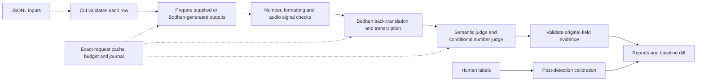

# Quality harness architecture

The harness takes an English source and an existing or generated Indic translation, plus optional audio. It reports localized quality concerns and shows when it cannot assess a check. The user can compare reports across runs. It does not repair translations.

The five exported Langflow nodes orchestrate these Python stages headlessly. Custom components are thin wrappers. The CLI owns dataset validation and reporting. The provider layer owns exact-request identity, bounded retries, budget admission and the run journal. Cache replay preserves successful responses and invocation decisions; runtime telemetry is separate from stable reports.

The compact number judge receives only unresolved, uniquely identifiable numeral residuals and full source and translation. Python assigns token IDs and validates returned IDs and original spans. Repeated values without a unique occurrence remain unresolved. Supported units are compared; unsupported suffixes or dimensions do not become confirmed judge findings. The semantic judge independently compares the source and translation; back-translation is supporting evidence and can be wrong. Neither judge writes or corrects Indic text.

Labels and injection metadata do not enter the graph. They join by item ID and language after detection. The 12 human-reviewed calibration items report descriptive metrics only: two previously inspected source groups do not support threshold tuning or reliable accuracy claims. The 120-item demo is also previously inspected and has eight underlying sources.

Audio checks cover PCM WAV duration, silence and clipping. Transcript alignment uses Bodhan Indic-Transcribe and retains original text spans; recognition can be wrong and no word timestamps are invented. Reference scoring, wrong-language detection, robust audio decoding, fresh human-reviewed evaluation, judge consistency and the 200-item speech-inclusive runtime target remain pending. See [README](README.md), [submission notes](SUBMISSION.md), and the [sample report](sample_report/summary.md).
